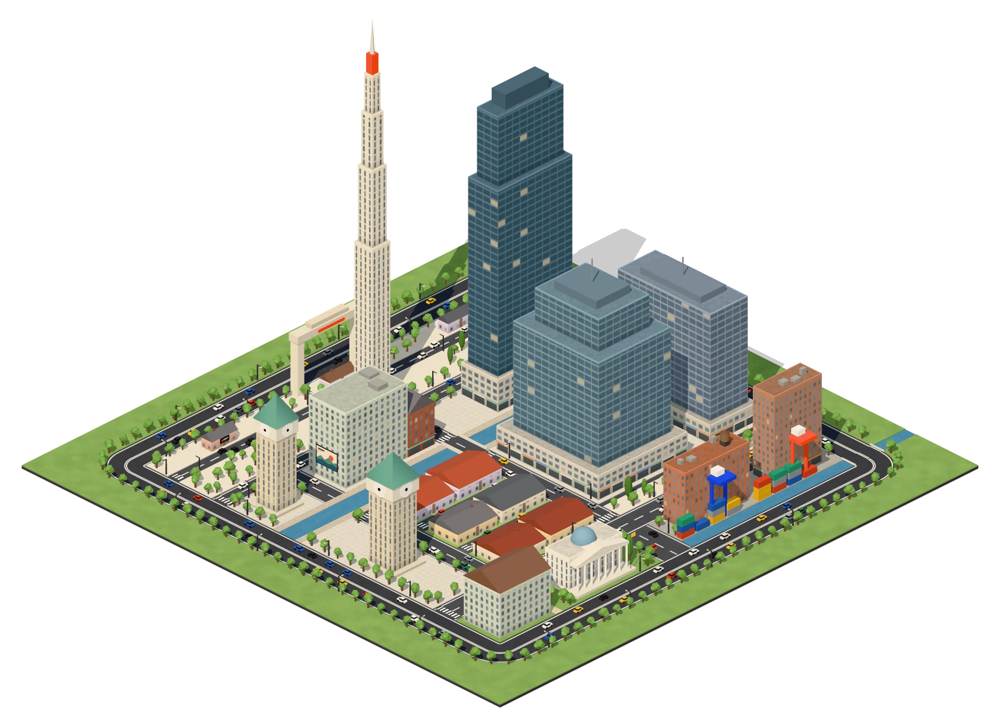
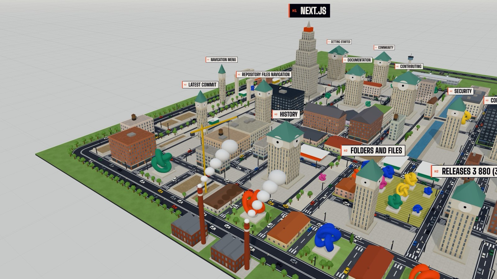
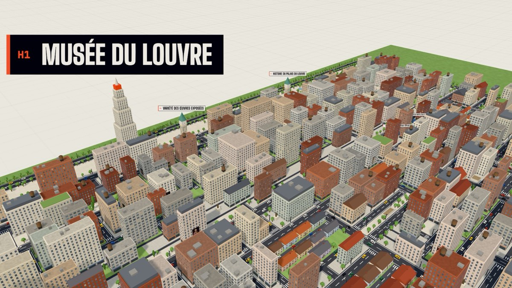
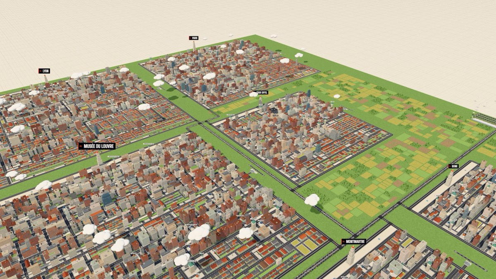

# DOMCity

**Every web page is a city.**

DOMCity reads the structure of a web page (its DOM) and builds it in 3D. Sections become districts, blocks become
buildings, headings become monuments, images become posters on the facades. You can fly over the city, inspect every
building to see what it was in the page, and walk its streets.

<p align="center">
  
</p>

**Try it:** [domcity.app](https://domcity.app) · **Make your own city:** [domcity.app/create](https://domcity.app/create)

The site speaks English and French: French when your browser asks for it, English otherwise, and a switcher in the
header remembers your choice.

## How it works

1. On [domcity.app/create](https://domcity.app/create), drag the DOMCity button into your bookmarks bar.
2. Open any web page and click the bookmark.
3. DOMCity opens in a new tab and the page rises from the ground as a city. Nothing leaves your browser until you
   click "Publish".

The bookmarklet is self-contained: about 10 KB of code live in the bookmark itself, nothing is loaded or injected
into the page, so it also works on sites with strict security policies. It only reads. On github.com/vercel/next.js
it captures 3,244 elements in 13 ms, and the city weighs 6 KB once compressed.



<sub>github.com/vercel/next.js, captured with the bookmarklet. The `<h1>` is the Art Deco tower, each `<h2>` a belfry
with its engraved plaque, the SVG icons are sculptures, the factories smoke for the page's scripts and the airport in
the back serves its links to other sites.</sub>

## From HTML to city

The city reads like the page: from left to right, then from north (the top of the page) to south. Streets are not in
the page: they separate the blocks and cut long rows into city blocks.

| In the page | In the city |
|---|---|
| `body` | The ground: the base of the model, its ring road and green belt |
| `section`, `article`, `main` | A district, separated from the others by wide avenues |
| `div` with children / with text / empty | A block lined with streets / An office building (a glass tower when there is a lot of text) / A construction site, sometimes with its crane |
| `p`, `blockquote`, `pre` | An apartment building in concrete, brick or render, with shops on the ground floor |
| `ul`, `ol` / `li` | A housing estate on a lawn / A house with a chimney |
| `h1` / `h2` / `h3` / `h4` to `h6` | An Art Deco tower that dominates the city / A clock belfry / A domed kiosk / A statue. The `h1` to `h3` carry their title on an engraved plaque |
| `img` | A poster with the real image, hung on a facade of the nearest building, Times Square style. Small icons become signs, small flags fly on a pole |
| `video`, `canvas` | A giant screen on a facade |
| `iframe` | An embassy with columns, under its flag |
| `svg` | An abstract sculpture |
| `form` / `button`, `input` | A town hall square with a fountain / A booth with an awning |
| `table` | Farm fields |
| `hr` | A canal between two quays, with its bridges |
| `nav`, `header`, `footer`, `aside` | A tree-lined promenade, the city gate, a harbor open to the sea, a park |
| Links to other sites | An airport outside the walls: up to 3 runways and 12 planes at the gates. The six most linked sites each have a plane in flight, and a click opens the departures board |

The full dictionary lives in [`src/format/taxonomy.ts`](src/format/taxonomy.ts) and the urban planning in
[`src/city/layout.ts`](src/city/layout.ts).

<p align="center">
  
</p>

## The ambiance

What the page does without showing it becomes visible in the city.

| In the page | In the city |
|---|---|
| Its weight (bytes loaded, number of elements) | The weather, from bright sun for a light page to a storm with rain and lightning for a heavy one |
| Scripts | Brick factories with smoking chimneys in the green belt, one for every six scripts |
| Ad trackers among the third-party hosts | Surveillance cameras on poles along the streets |
| HTML comments | Graffiti at the foot of the walls: "TODO", "FIXME", "HACK"... (the text of the comments is never read) |
| Broken images | Ruins where the poster should be |
| Background colors | The site's true colors on walls, roofs and grounds, as an option |

## The megalopolis

Every capture is a dated version of a page. All the pages of a site come together in a megalopolis: each page is a
city, placed according to its address (the path becomes the geography). When one page links to another, a highway
connects their cities. The site gets a large shared airport, and every city open enough to the web keeps its own
airfield.



## Privacy

- The text of the page is never stored, only how much there is. The one exception is the `h1` to `h3` headings
  (shortened to 120 characters), engraved on the monuments. The list is shown before publishing.
- Addresses are cleaned: no `?query`, no `#anchor`, no `www.`.
- Nothing leaves the browser until "Publish" is clicked. The bookmarklet never reads paragraphs, form fields or
  cookies.
- Links to other pages of the same site are only kept as fingerprints (FNV-1a hashes of their paths): a private path
  cannot be read in a shared city.
- Each shared city comes with a secret deletion link. Its token sits after the `#`, so it is never sent to the server
  in the address, and the database only keeps its SHA-256 hash.
- To know whether a site is refused, the browser downloads the whole list and checks on its own: DOMCity never learns
  which page is being captured.

## Refused sites

Some sites never become cities: adult sites, violence and shocking images, banks and financial services, personal
data (email, accounts, taxes, health), gambling and dangerous sites (IP loggers, spyware, pirated downloads). Any page
that declares itself adults only is refused too. Images from these sites are never loaded, even when they appear in
another site's city.

The list (1,553 entries to start with) lives in the database, so it can grow without a redeploy, and the database
itself refuses to publish a city for a site on it. See [`docs/refused-sites.md`](docs/refused-sites.md).

## Under the hood

- **Next.js 16** (App Router) and **React 19**, in a single repository: the site, the API and the bookmarklet.
- **Two languages, one address**: every page exists in English and French (`app/[locale]/`, prerendered in both), and
  the proxy picks one from the switcher's cookie or the browser's languages without changing the address, so a shared
  link opens in the language of whoever opens it.
- **Three.js** for the city: instanced meshes (a few dozen draw calls for thousands of buildings, trees and cars),
  shaders that draw windows, road markings and lawns at the real scale of each instance, an atlas for all the small
  icons. The view only renders when something moves.
- **Supabase** (Postgres, row level security, SQL functions, `pg_trgm` for typo-tolerant search) for sites, pages and
  versions. All writes go through the API.
- **Cloudflare R2** for the city files (gzip-compressed JSON) and their thumbnails.
- **esbuild** compiles the capture and the bookmarklet into a single `javascript:` line.
- **Vitest**, with **PGlite** running the real SQL migrations, for the tests.
- Hosted on **Vercel**.

A stored city is a description of the page, never a drawing. Shapes, colors, heights and placement are computed by the
engine every time a city opens, so improving the engine improves every city, old and new.

```
bookmarklet ──► /new ──► validation (zod) ──► layoutCity ──► buildCityScene ──► CityView
 (any page)    (new tab,                          (urban plan)   (Three.js)
               postMessage)                            │
                                                       └──► Publish ──► API ──► Supabase + R2
```

### Project structure

```
src/
├── app/            Next.js routes under [locale]: home, /create, /explore, /account, /city/…, /site/…, /w/… (Wikipedia); API
├── i18n/           languages: detection, formatting, and the messages of the interface in English and French
├── format/         the city format: types, zod schema, limits, addresses, the HTML → city dictionary, blocklist
├── capture/        web page → city JSON (no dependencies, compiled into the bookmarklet); Wikipedia mode
├── bookmarklet/    the bookmarklet: entry point, exchange with /new, compiled version
├── city/           urban planning (layout), megalopolis, ambiance, Three.js scene, view and controls
├── server/         storage modes, database (Supabase or local), files (R2 or local), security, sharing
├── ui/             interface components: explorer, inspector, legend, share panel, bookmarklet demo…
└── proxy.ts        serves each page in the visitor's language, without changing its address
scripts/            bookmarklet build (esbuild)
supabase/           SQL migrations and the database check script
docs/               refused sites list, roadmap (in French), README images
```

## Getting started

You need Node.js 20.9 or later.

```bash
npm install
npm run dev
```

Open [localhost:3000](http://localhost:3000). Without any configuration, development runs in **local mode**: an
embedded Postgres database (PGlite) runs the real migrations, and city files are stored in `.data/`. Sharing,
search, the gallery and the megalopolis all work without an account.

- Install the bookmarklet from [localhost:3000/create](http://localhost:3000/create): it points back to the site that
  served it, so a bookmark installed from localhost sends its cities to localhost.
- Any Wikipedia article (fr, en, de, es, it) can be visited directly, for example
  [localhost:3000/w/en/Paris](http://localhost:3000/w/en/Paris).

| Command | What it does |
|---|---|
| `npm run dev` | Development server, sharing in local mode |
| `npm test` | 125 tests: capture, bookmarklet, urban planning, megalopolis, sharing end to end on the local database, languages |
| `npm run lint` | ESLint |
| `npm run typecheck` | TypeScript |
| `npm run bookmarklet` | Recompiles the bookmarklet (`src/bookmarklet/generated.ts`) after a change in `src/capture` or `src/bookmarklet` |
| `npm run build` | Production build (recompiles the bookmarklet first) |

### Development tools

These only exist in development:

- `/dev/figure` renders the home page figure with the real engine and saves it; `/dev/legend` does the same for the
  legend thumbnails. A test fails when the urban plan they show has changed.
- `window.__domcity` exposes the 3D view in the console: `lookFrom([x, y, z], [cx, cy, cz])` places the camera,
  `capture()` returns the image.
- `window.__demo(7.7)` stops the bookmarklet demo of the `/create` page on a given second.

## Deploying

Sharing switches to **cloud mode** when all the variables of [`.env.example`](.env.example) are set (without them, in
production, sharing is simply hidden).

1. **Supabase**: create a project, paste each file of `supabase/migrations/` into the SQL Editor, in order, then paste
   `supabase/verification.sql`. Every line of its result must say `ok`.
2. **Cloudflare R2**: create a bucket, an API token with "Object Read & Write" on it, a public domain for the files,
   and a CORS rule that allows `GET` and `HEAD` from your site.
3. **Vercel**: import the repository and enter the environment variables.

## Contributing

- Code, comments, tests and documentation are in English. The interface texts live in `src/i18n/messages`, English
  and French side by side: TypeScript refuses a message that exists in one language and not in the other.
- Run `npm test`, `npm run lint` and `npm run typecheck` before sending a change.
- Never edit a SQL migration that may already be applied: add a new one.
- The design follows a few rules: no em dashes in texts, barely rounded corners, calm colors with vivid accents that
  carry meaning (construction orange for actions and monuments, beacon yellow for hover and selection).
- Decisions, the history of the project and what comes next are in [`docs/ROADMAP.md`](docs/ROADMAP.md) (in French).

## License

DOMCity is released under the [MIT license](LICENSE). It covers the code; it does not allow using the DOMCity name
or logo to present another site.

## Credits

Built with [Three.js](https://threejs.org), [Next.js](https://nextjs.org), [Supabase](https://supabase.com) and the
Big Shoulders, Instrument Sans and Martian Mono typefaces. Headings taken from Wikipedia articles are under the
CC BY-SA license.
